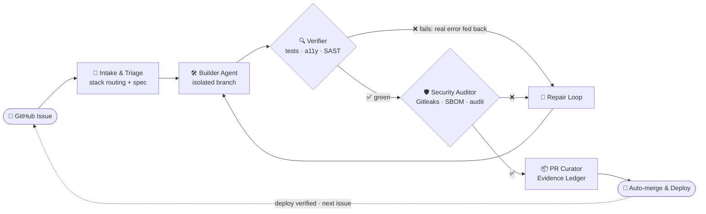

# Hi, I'm Rajeev Sharma 👋

**Software professional building an autonomous Software Factory — where AI agents turn GitHub Issues into tested, secured, deployed software in a loop.**

[-6e40c9?logo=github)](https://github.com/rajeevkannav/ProductionLine)

---

## 🏭 What I'm building: [ProductionLine (`mogra`)](https://github.com/rajeevkannav/ProductionLine)

A **convention-first, security-hardened open-source Software Factory**. Open an issue on any onboarded repo and a pipeline of single-purpose AI agents takes it from idea to production — with **no agent grading its own homework**.

### 🤖 Agents working in a loop

| Agent | Role in the loop | Can't touch |
| :--- | :--- | :--- |
| `discovery-ideator` · `triage-architect` | Read the issue, stamp the stack, write the spec | Code |
| `frontend-builder` · `rails-fullstack-builder` · `mobile-native-builder` | Build the feature on an isolated branch | Tests' gates, CI workflows, config |
| `qa-reflow-verifier` | Unit + E2E, 320px reflow, axe-core WCAG 2.2 AA | App code |
| `security-auditor` | Protected paths, Gitleaks, Brakeman, `npm audit`, CycloneDX SBOM | App code |
| `pr-curator` | Evidence Ledger, auto-merge, deploy check | App code |

When a gate fails, the builder gets the **real error** and a clean environment, patches surgically, and goes round again — until every gate is green or the run is rejected.

### ⚙️ Highlights

- **Pluggable harnesses & models** — Gemini CLI, Claude Code, OpenAI Codex, Antigravity, Goose, OpenHands, Aider, with per-agent model overrides
- **Zero-boilerplate onboarding** — a ~20-line workflow caller and a spoke repo inherits the whole factory
- **Security first** — least-privilege jobs, no shell injection, protected CI boundaries, CodeQL, Dependabot
- **Beyond SPAs** — React 19 / Vue / Svelte / Angular / Solid, **Rails 8 + PostgreSQL + Hotwire** grown one issue at a time, and Hotwire Native Android/iOS clients
- **Deploys anywhere free** — GitHub Pages, Railway + Neon, Render, or mobile artifacts

### 🧪 Built by the factory

| Repo | What the agents shipped |
| :--- | :--- |
| [**TodoMVC-Plus**](https://github.com/rajeevkannav/TodoMVC-Plus) | 5-stack TodoMVC+ showcase, built & deployed autonomously |
| [**JumpStart_Pro_Plus**](https://github.com/rajeevkannav/JumpStart_Pro_Plus) | Rails 8 + Hotwire SaaS starter, built feature-per-issue |

---

## 🧠 About me

I've designed and delivered complex software across startups and global consulting firms, led teams, and shaped technology strategy. Today I'm focused on **agentic software delivery** — making AI agents reliable enough to trust with the whole SDLC by surrounding them with independent verification, security gates, and evidence.

I enjoy mentoring young developers and sharing what I learn.

**Interests:** Agentic AI & software factories · Software architecture · Clean code · Cloud infrastructure · DevSecOps & supply-chain security · Accessibility

**Toolbox:** Ruby on Rails · Node.js · TypeScript · GitHub Actions · PostgreSQL · Hotwire · Playwright · AWS

### 🎓 Education

- **Master of Computer Applications**, 2009 — Chaudhary Devi Lal University, Sirsa, Haryana
- **B.Sc. (Electronics)**, 2006 — Kurukshetra University, Kurukshetra

---

⭐ If the idea of an issue-to-production agent loop interests you, [star ProductionLine](https://github.com/rajeevkannav/ProductionLine) or open an issue — contributions welcome.

