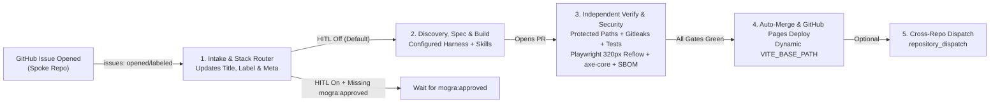

# ProductionLine (Codename: `mogra`)

**ProductionLine (`mogra`)** is a convention-first, security-hardened **Open-Source Software Factory** driven by GitHub Issues.
Onboarded repositories (such as [`TodoMVC-Plus`](https://github.com/rajeevkannav/TodoMVC-Plus)) run the full SDLC—**Intake & Stack Tagging → Discovery & Ideation → Spec → Build → Independent Verification → Security & SBOM → Auto-Merge → GitHub Pages Deployment**—with Human-in-the-Loop (HITL) disabled by default.

---

## End-to-End Factory Loop



---

## Dedicated Documentation

| Area | Document | What It Covers |
| :--- | :--- | :--- |
| **Agents & SDLC Loop** | [agents/README.md](agents/README.md) | The 6 specialized SDLC agents, builder/verifier isolation, and sequence diagram. |
| **Models & Harnesses** | [harnesses/README.md](harnesses/README.md) | `antigravity`, `gemini-cli`, `claude-code`, `codex`, `goose`, `openhands`, `aider`, model opt-in, and sandbox flow. |
| **Capabilities & Skills** | [skills/README.md](skills/README.md) | All 7 portable `SKILL.md` modules (WCAG 2.2 AA+ reflow, modern CSS, local-first, security, QA) and skill-to-stage map. |
| **Spoke Onboarding (`TodoMVC+`)** | [templates/spoke/README.md](templates/spoke/README.md) | Exact 2-file onboarding setup, secrets, and GitHub Pages configuration. |
| **Security Policy** | [SECURITY.md](SECURITY.md) | Private vulnerability reporting and built-in CI/supply-chain safeguards. |

---

## Conventions Over Configuration

Zero-config defaults live in [`src/conventions.mjs`](src/conventions.mjs). Spoke repositories need no `.mogra.yaml` unless overriding defaults:

| Concern | Convention Default | Override Key |
| :--- | :--- | :--- |
| **Harness & Model** | `antigravity` / `gemini-3.1-flash-lite` | `runtime.harness`, `runtime.model`, `agents.<name>` |
| **Human-in-the-Loop** | `false` (autonomous end-to-end) | `human_in_the_loop.enabled` |
| **Outcome & Stacks** | `todomvc-plus` (`react19-ts-vite`, `vue3-ts-vite`, `svelte5-ts-vite`, `angular-ts`, `solid-ts-vite`) | `outcome.blueprint`, `outcome.stack` |
| **Verification Gates** | Independent verifier, 320px reflow, WCAG 2.2 AA zero violations, Gitleaks, SBOM, Evidence Ledger | `gates.*` |
| **Deployment** | GitHub Pages (`VITE_BASE_PATH` auto-resolved; custom domain ready) | `deployment.*` |

---

## Security & Vulnerability Controls

1. **Least-Privilege Workflows:** Top-level `permissions: {}` with minimal per-job permissions and `persist-credentials: false` on read-only checkouts.
2. **Injection Prevention:** Untrusted issue titles/bodies are always passed via `env:` variables—never interpolated into `run:` shell commands.
3. **Immutable Verification Boundary:** `verify-and-security` fails any automated PR that modifies `.github/workflows/` or `.mogra.yaml`.
4. **Supply-Chain Gates:** Gitleaks secret scanning, `npm audit --audit-level=high`, CycloneDX SBOM artifact upload (`sbom.cdx.json`), and weekly Dependabot updates.
5. **Cross-Model Independence:** Assign different harnesses/models to `frontend-builder` and `qa-reflow-verifier` in `.mogra.yaml` to avoid shared blind spots.

---

## Required GitHub Secrets & Settings

Set secrets via GitHub Repository/Organization Settings or `gh secret set` (never commit secrets):

| Secret | Required? | Purpose |
| :--- | :--- | :--- |
| `MOGRA_BOT_TOKEN` | **Yes** (for auto-merge + Pages + cross-repo) | Fine-grained PAT (`Contents R/W`, `Issues R/W`, `Pull requests R/W`, `Metadata R`, plus `Actions R/W` for dispatch). |
| `GEMINI_API_KEY` | **Yes** (default `antigravity` / `gemini-cli`) | Authenticates Google Antigravity / Gemini models. |
| `ANTHROPIC_API_KEY` | Optional | Needed only when overriding an agent to `claude-code`. |
| `OPENAI_API_KEY` | Optional | Needed only when overriding an agent to `codex`. |

---

## Local CLI & Verification

```sh
npm run validate
npm test
node src/cli.mjs plan-agent --agent frontend-builder
```
