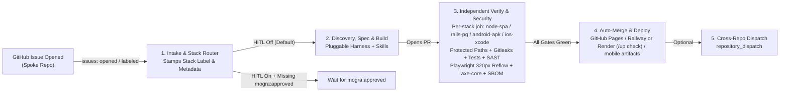

<div align="center">

# ProductionLine (`mogra`)

**Convention-first, security-hardened Open-Source Software Factory driven by GitHub Issues.**

[](https://github.com/rajeevkannav/ProductionLine/actions/workflows/mogra-ci.yml)
[](https://github.com/rajeevkannav/ProductionLine/actions/workflows/codeql.yml)
[](https://github.com/rajeevkannav/ProductionLine/releases)
[](LICENSE)
[](package.json)
[](https://github.com/rajeevkannav/TodoMVC-Plus)

*Open a GitHub Issue on any onboarded repository → **Intake & Stack Tagging → Discovery & Spec → Isolated Build → Independent Verification (tests, WCAG 2.2 AA reflow, SAST) → Gitleaks & SBOM → Auto-Merge → Deploy (GitHub Pages, Railway + Neon, Render, or mobile artifacts)**.*

</div>

---

## Why ProductionLine (`mogra`)?

- **Zero-Boilerplate Onboarding:** Spoke repos add one ~20-line workflow caller ([`templates/spoke/.github/workflows/mogra.yml`](templates/spoke/.github/workflows/mogra.yml)) and inherit all factory conventions automatically.
- **No Grading Your Own Homework:** Builder, Verifier, Security Auditor, and PR Curator run as isolated roles ([`agents/README.md`](agents/README.md)). Builders cannot weaken tests or modify `.github/workflows/` or `.mogra.yaml`.
- **Pluggable Models & Harnesses:** Run **Gemini CLI** (Free Tier `gemini-3.1-flash-lite` ready), **Google Antigravity SDK**, **Claude Code**, **OpenAI Codex**, **Goose**, **OpenHands**, or **Aider**—with per-agent model overrides ([`harnesses/README.md`](harnesses/README.md)).
- **Accessibility & Modern Web Built In:** Enforces WCAG 2.2 AA+, `320px` / 400% zoom zero-overflow reflow, Container Queries, `:has()`, `OKLCH`, `light-dark()`, View Transitions, local-first IndexedDB + `BroadcastChannel`, and `@axe-core/playwright` gates ([`skills/README.md`](skills/README.md)).
- **Security & Supply-Chain First:** Least-privilege `permissions: {}` per job, env-bound inputs (zero shell injection), protected CI boundaries, Gitleaks secret scanning, `npm audit`, CycloneDX SBOMs, CodeQL, and Dependabot.
- **Beyond SPAs (v0.2.0):** Grow a full-stack **Rails 8 + PostgreSQL + Hotwire** app one issue at a time (`incremental-feature` mode) with Minitest, RuboCop, **Brakeman**, and `bundler-audit` gates, deploy it to **Railway + Neon** (no credit card) or **Render**, and build **Hotwire Native** Android (`.apk`) and iOS clients from the same repo.

---

## End-to-End Factory Loop



---

## 60-Second Quickstart (Onboard a Spoke Repo)

1. Copy [`templates/spoke/.github/workflows/mogra.yml`](templates/spoke/.github/workflows/mogra.yml) into your target repository (e.g., [`TodoMVC-Plus`](https://github.com/rajeevkannav/TodoMVC-Plus)).
2. Add repository secrets (`MOGRA_BOT_TOKEN` and `GEMINI_API_KEY`, plus optional `ANTHROPIC_API_KEY` / `OPENAI_API_KEY`) and enable **Actions write/PR permissions**, **Allow auto-merge**, and **GitHub Pages (GitHub Actions)**.
3. Open an issue—`mogra` handles everything from stack tagging through live deployment.

See [`templates/spoke/README.md`](templates/spoke/README.md) for the exact step-by-step setup.

**Rails spoke (v0.2.0):** copy [`templates/spoke-rails/`](templates/spoke-rails/) instead. It adds `.mogra.yaml` (`rails8-pg-hotwire`, `incremental-feature`, `deployment.target: railway`), CodeQL, and issue templates. Skip the GitHub Pages step; after the first PR merges, create a Neon database and a Railway service from the repo, then set `DATABASE_URL` and `RAILS_MASTER_KEY`. Neither needs a credit card, so the app can never be billed: when Railway's free credit runs out the service stops. Render (`deployment.target: render`) is still supported but asks for a card. Full guide: [`templates/spoke-rails/README.md`](templates/spoke-rails/README.md).

### Sub-issue chains

Large features run more reliably as small issues. Create a parent issue labelled `mogra:epic` (mogra never builds it) and add the steps as GitHub **sub-issues** in order, each labelled `mogra:queued` so opening them does not start a run. Start the first one with the `mogra:run` label. Each time a sub-issue is verified, merged and deployed, `mogra` starts the parent's next open sub-issue; after the last one it closes the parent. Parents can themselves be sub-issues of a roadmap epic: when a milestone closes, `mogra` moves on to the next milestone's first open sub-issue, and pauses (with a comment) at a milestone that has no sub-issues yet. A failed run stops the chain: fix and re-run that sub-issue with `mogra:run`, and the chain continues. Chaining uses `MOGRA_BOT_TOKEN` (events from `github.token` do not trigger workflows).

### Secrets

| Secret | When | Purpose |
| :--- | :--- | :--- |
| `MOGRA_BOT_TOKEN` | Always | Fine-grained PAT whose **Repository access includes the spoke repo**, with Contents, Issues, Pull requests: Read and write. The same token can be stored in several spokes if its access list covers each one. |
| `GEMINI_API_KEY` | Default harness | Or `ANTHROPIC_API_KEY` / `OPENAI_API_KEY` for `claude-code` / `codex`. |
| `RAILS_MASTER_KEY` | Rails stack | 32-hex key (`openssl rand -hex 16`). `mogra` encrypts the new app's `config/credentials.yml.enc` with it during `rails new`; set the same value on the host. Never committed. |
| `RAILWAY_APP_URL` | `railway` target, optional | Public Railway URL; `mogra` polls `/up` after merge. |
| `RENDER_DEPLOY_HOOK_URL`, `RENDER_APP_URL` | `render` target, optional | Trigger the deploy after merge and poll `/up`. |
| `ANDROID_KEYSTORE_BASE64`, `ANDROID_KEY_ALIAS`, `ANDROID_KEYSTORE_PASSWORD`, `ANDROID_KEY_PASSWORD` | Signed Android release | Not needed for debug `.apk`. |

---

## Dedicated Documentation

| Area | Guide | Covers |
| :--- | :--- | :--- |
| **Agents & SDLC Loop** | [agents/README.md](agents/README.md) | Eight single-purpose SDLC agents (incl. `rails-fullstack-builder`, `mobile-native-builder`), write boundaries, and Mermaid sequence diagram. |
| **Models & Harnesses** | [harnesses/README.md](harnesses/README.md) | `gemini-cli`, `antigravity`, `claude-code`, `codex`, `goose`, `openhands`, `aider`, and Free-Tier/Paid routing. |
| **Capabilities & Skills** | [skills/README.md](skills/README.md) | Twelve modular `SKILL.md` contracts (`wcag-reflow-a11y`, `ultra-modern-web-css`, `security-hardening`, `rails-multi-tenant-security`, `railway-neon-free-tier-ops`, `render-free-tier-ops`, `hotwire-native-mobile`, etc.). |
| **Showcase Spoke (`TodoMVC+`)** | [templates/spoke/README.md](templates/spoke/README.md) | Live 5-stack showcase setup (`React 19`, `Vue 3.5`, `Svelte 5`, `Angular`, `Solid`). |
| **Rails Spoke (Railway + Neon)** | [templates/spoke-rails/README.md](templates/spoke-rails/README.md) | Feature-per-issue Rails 8 app on Railway + Neon (or Render) with Hotwire Native clients (reference: [`JumpStart_Pro_Plus`](https://github.com/rajeevkannav/JumpStart_Pro_Plus)). |
| **Contributing & Security** | [CONTRIBUTING.md](CONTRIBUTING.md) · [SECURITY.md](SECURITY.md) | Local checks, adding skills/harnesses, and vulnerability reporting. |

---

## Conventions Over Configuration

Zero-config defaults live in [`src/conventions.mjs`](src/conventions.mjs). Spoke repositories omit `.mogra.yaml` unless overriding defaults:

| Concern | Convention Default | Override Key |
| :--- | :--- | :--- |
| **Harness & Model** | `gemini-cli` / `gemini-3.1-flash-lite` | `runtime.harness`, `runtime.model`, `agents.<name>` |
| **Human-in-the-Loop** | `false` (autonomous end-to-end) | `human_in_the_loop.enabled` |
| **Supported Stacks** | `react19-ts-vite`, `vue3-ts-vite`, `svelte5-ts-vite`, `angular-ts`, `solid-ts-vite`, `rails8-pg-hotwire`, `android-hotwire-native`, `ios-hotwire-native` | `outcome.stack` |
| **Delivery Mode** | `greenfield-stack` (`incremental-feature` for existing repos) | `outcome.mode`, `outcome.capabilities` |
| **Verification Gates** | Protected paths, Gitleaks, unit + Playwright `320px` reflow + `axe-core`, SBOM, Evidence Ledger; Rails adds Minitest, RuboCop, Brakeman, `bundler-audit` | `gates.*` |
| **Deployment** | GitHub Pages (`VITE_BASE_PATH` auto-resolved; custom domain ready); also `railway`, `render` and `mobile-release` | `deployment.*` |

---

## Local Verification & Contributing

```sh
npm run check
```

Runs schema/config validation (`node src/cli.mjs validate`), unit tests (`node --test tests/*.test.mjs`), and shell syntax checks (`bash -n scripts/run-agent.sh`). Licensed under the [MIT License](LICENSE).
