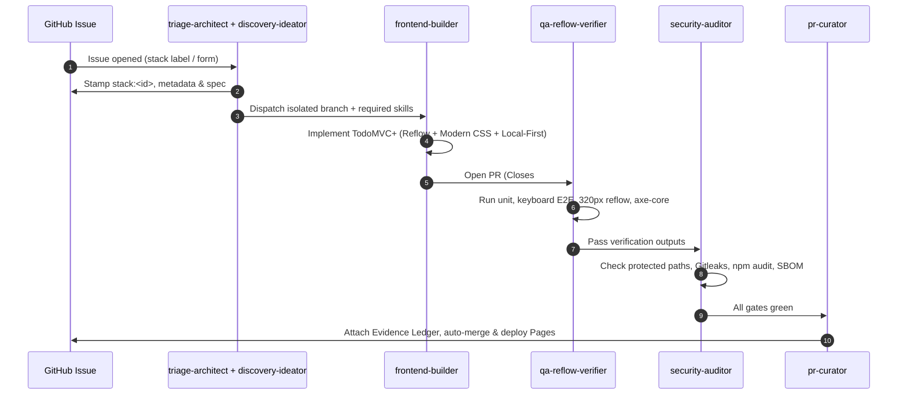

# ProductionLine (`mogra`) Agents Guide

`mogra` splits software delivery across **eight single-purpose agents** defined in [`registry.yaml`](registry.yaml). Splitting Builder, Verifier, and Security roles prevents the **"grading your own homework"** failure mode.

---

## Agent Interaction Loop



---

## Agent Catalog

| Agent | SDLC Stage | Skills Loaded | Write Boundary |
| :--- | :--- | :--- | :--- |
| **`discovery-ideator`** | `discovery` | `issue-stack-router`, `wcag-reflow-a11y`, `ultra-modern-web-css` | Issue comments only |
| **`triage-architect`** | `spec` | `issue-stack-router`, `wcag-reflow-a11y`, `ultra-modern-web-css`, `local-first-resilience`, `security-hardening` | Issue labels/body/spec |
| **`frontend-builder`** | `build` | `wcag-reflow-a11y`, `ultra-modern-web-css`, `local-first-resilience`, `security-hardening` | App code & unit tests (no CI/config edits) |
| **`rails-fullstack-builder`** | `build` | `rails-multi-tenant-security`, `quantumblack-rails-ui`, `render-free-tier-ops`, `wcag-reflow-a11y`, `security-hardening` | App code & Minitest (no CI/config edits) |
| **`mobile-native-builder`** | `build` | `hotwire-native-mobile`, `security-hardening` | `clients/android`, `clients/ios` (no CI/config edits) |
| **`qa-reflow-verifier`** | `verify` | `playwright-a11y-reflow-gate`, `evidence-first-reporting` | Verification artifacts & checks |
| **`security-auditor`** | `security` | `security-hardening`, `rails-multi-tenant-security`, `evidence-first-reporting` | SBOM & security reports |
| **`pr-curator`** | `review-merge` | `evidence-first-reporting`, `issue-stack-router` | PR Evidence Ledger & release status |

---

## Per-Agent Model & Harness Overrides

Any agent omitted from `agents:` inherits `runtime.harness` and `runtime.model`. Override selectively in `mogra.yaml` or a spoke `.mogra.yaml`:

```yaml
version: 1
runtime:
  harness: antigravity
  model: gemini-2.5-pro

agents:
  frontend-builder:
    harness: codex
    model: gpt-5-codex
  qa-reflow-verifier:
    harness: claude-code
    model: claude-sonnet-4-5
```

Inspect the resolved execution plan for any agent locally:

```sh
node src/cli.mjs plan-agent --agent qa-reflow-verifier
```
