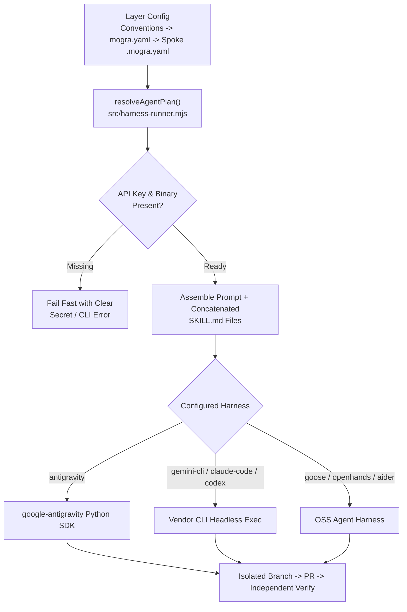

# Models & Execution Harnesses Guide

**ProductionLine (`mogra`)** decouples SDLC orchestration from any single AI CLI or model vendor. Every agent can run on **Google Antigravity**, **Gemini CLI**, **Claude Code**, **OpenAI Codex**, **Goose**, **OpenHands**, or **Aider**—configured declaratively via `mogra.yaml` or `.mogra.yaml`.

---

## Harness Resolution & Sandbox Loop



---

## Supported Harnesses & Models

| Harness ID | Runner / Tool | Default Model | Required Secret Env Var | Best Used For |
| :--- | :--- | :--- | :--- | :--- |
| **`antigravity`** *(default)* | `google-antigravity` Python SDK | `gemini-3.1-flash-lite` | `GEMINI_API_KEY` | Default Google Antigravity Free-Tier-ready autonomous runs |
| **`gemini-cli`** | `gemini` CLI | `gemini-3.1-flash-lite` | `GEMINI_API_KEY` | Lightweight terminal headless execution |
| **`claude-code`** | `claude` CLI | `claude-sonnet-4-5` | `ANTHROPIC_API_KEY` | Opt-in Anthropic reasoning/coding or cross-model review |
| **`codex`** | `codex` CLI | `gpt-5-codex` | `OPENAI_API_KEY` | Opt-in OpenAI Codex execution |
| **`goose`** | Block `goose` CLI | `gemini-2.5-pro` | `GEMINI_API_KEY` | MCP-native extensible local/CI workflows |
| **`openhands`** | OpenHands headless | `gemini-2.5-pro` | `GEMINI_API_KEY` | Containerized multi-step SWE tasks |
| **`aider`** | `aider` CLI | `gemini/gemini-2.5-pro` | `GEMINI_API_KEY` | Fast git-diff focused edits |
| **`deterministic-ci`** | `npm` / CI runners | `none` | *(none)* | Non-LLM deterministic checks |

---

## Opting Into Models

### Factory-Wide Default (`mogra.yaml`)
```yaml
version: 1
runtime:
  harness: antigravity
  model: gemini-3.1-flash-lite
```

### Cross-Model Spoke Override (`.mogra.yaml`)
```yaml
version: 1
agents:
  triage-architect:
    harness: antigravity
    model: gemini-2.5-pro
  frontend-builder:
    harness: claude-code
    model: claude-sonnet-4-5
  qa-reflow-verifier:
    harness: codex
    model: gpt-5-codex
```

---

## Security Guardrails for Harnesses

- [`scripts/run-agent.sh`](../scripts/run-agent.sh) runs with `set -euo pipefail`, validates required API key env vars before execution, and never passes untrusted issue strings directly to `eval`.
- Harnesses only commit to feature branches (`mogra/issue-<n>-<stack>`); protected CI workflows and `.mogra.yaml` cannot be modified by automated PRs.
