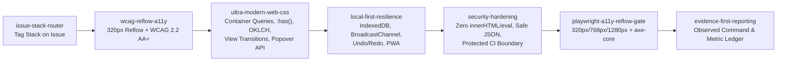

# ProductionLine (`mogra`) Skills Guide

Skills are small, reusable `SKILL.md` capability contracts injected automatically into an agent's runtime prompt by [`src/harness-runner.mjs`](../src/harness-runner.mjs). This keeps requirements **DRY** and guarantees every TodoMVC+ stack (React, Vue, Svelte, Angular, Solid) hits the same accessibility, reflow, modern web, and security bar.

---

## How Skills Drive the SDLC Loop

---

## Skill Catalog

| Skill | File | Core Contract Enforced |
| :--- | :--- | :--- |
| **`issue-stack-router`** | [`issue-stack-router/SKILL.md`](issue-stack-router/SKILL.md) | Resolves stack (`react19-ts-vite`, `vue3-ts-vite`, `svelte5-ts-vite`, `angular-ts`, `solid-ts-vite`), applies `stack:<id>`, and stamps issue metadata. |
| **`wcag-reflow-a11y`** | [`wcag-reflow-a11y/SKILL.md`](wcag-reflow-a11y/SKILL.md) | Zero horizontal scroll at `320px` / 400% zoom, full keyboard navigation, focus restoration, `aria-live`, `prefers-reduced-motion`, `forced-colors`. |
| **`ultra-modern-web-css`** | [`ultra-modern-web-css/SKILL.md`](ultra-modern-web-css/SKILL.md) | `@container`, `:has()`, CSS Subgrid, `@layer`, `OKLCH`, `light-dark()`, `startViewTransition()`, native `popover` + Anchor Positioning. |
| **`local-first-resilience`** | [`local-first-resilience/SKILL.md`](local-first-resilience/SKILL.md) | Versioned IndexedDB persistence, `BroadcastChannel` cross-tab sync, Undo/Redo stack, validated JSON import/export, offline PWA. |
| **`security-hardening`** | [`security-hardening/SKILL.md`](security-hardening/SKILL.md) | No `eval`/`innerHTML`/`v-html`, prototype-pollution-safe JSON parsing, CSP readiness, zero secrets in repo, immutable CI boundary. |
| **`playwright-a11y-reflow-gate`** | [`playwright-a11y-reflow-gate/SKILL.md`](playwright-a11y-reflow-gate/SKILL.md) | Verifies `scrollWidth <= innerWidth` at `320x568`, keyboard-only CRUD, multi-tab sync, and zero `@axe-core/playwright` violations. |
| **`evidence-first-reporting`** | [`evidence-first-reporting/SKILL.md`](evidence-first-reporting/SKILL.md) | Requires exact commands, exit codes, and observed metrics; missing checks must be marked `NOT RUN`. |

---

## Extending Skills for Backend or Complex Repos

Keep frontend, backend, and verification skills modular under `skills/<skill-name>/SKILL.md` and bind them to agents in [`agents/registry.yaml`](../agents/registry.yaml). No changes to the CLI core are required.
